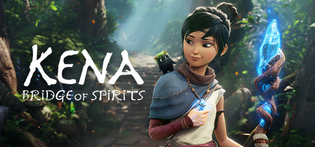

**Kena: Bridge of Spirits is a visually stunning action-adventure following a young spirit guide through a beautifully crafted world clearing corruption and guiding lost souls. Features tight parry-based combat, a growing army of adorable Rot companions, and demanding bosses.**

---

## 📖 About

Kena: Bridge of Spirits is a visually stunning action-adventure following a young spirit guide through a beautifully crafted world clearing corruption and guiding lost souls. Features tight parry-based combat, a growing army of adorable Rot companions, and demanding bosses.

## ⚠️ Problems Without Trainer

| Problem | Status |
|---------|--------|
| **Parry Window** — Boss attacks require very tight parry timing on Spirit Guardian difficulty | ✅ Solved |
| **Rot Hat Grind** — Finding all Rot hats and flowers requires exhaustive exploration | ✅ Solved |
| **Spirit Mail Collectibles** — Missing even one can require revisiting entire areas | ✅ Solved |
| **Boss HP** — Boss endurance tests on harder difficulties create very long encounter windows | ✅ Solved |

## ✅ Solution

The **Kena: Bridge of Spirits Trainer** solves all these issues by giving you complete control over the game.

## 🎯 Full Feature List

- Unlimited Resources
- God Mode / Invincibility
- Instant Skill Cooldown
- One-Hit Kill
- Freeze Game Timer
- Unlock All Items & Achievements
- Custom Speed Multiplier
- Save State Anywhere

## 🚀 Quick Start

1. **Disable Windows Defender** temporarily (trainer may trigger false positive)
2. Download the trainer from the button above
3. Launch Kena: Bridge of Spirits
4. Run the trainer as Administrator
5. Activate desired cheats with hotkeys

## 💎 Free vs Paid

| Feature | Free | Pro |
|---------|------|-----|
| Basic God Mode | ✅ | ✅ |
| Unlimited Resources | ✅ | ✅ |
| All Advanced Cheats | ❌ | ✅ |
| Auto-Updates | ❌ | ✅ |
| Priority Support | ❌ | ✅ |

## 💻 Requirements

- Windows 10/11 (64-bit)
- Kena: Bridge of Spirits (any version)
- .NET Framework 4.8+
- DirectX 11+

## 🍎 macOS

macOS users can use our alternative tool:

## ⚖️ Legal

This trainer is for educational and single-player use only. Use responsibly.

---

